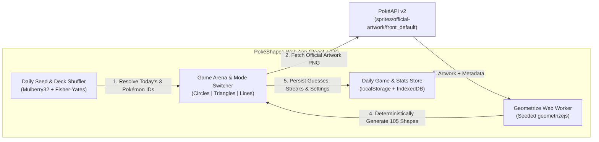
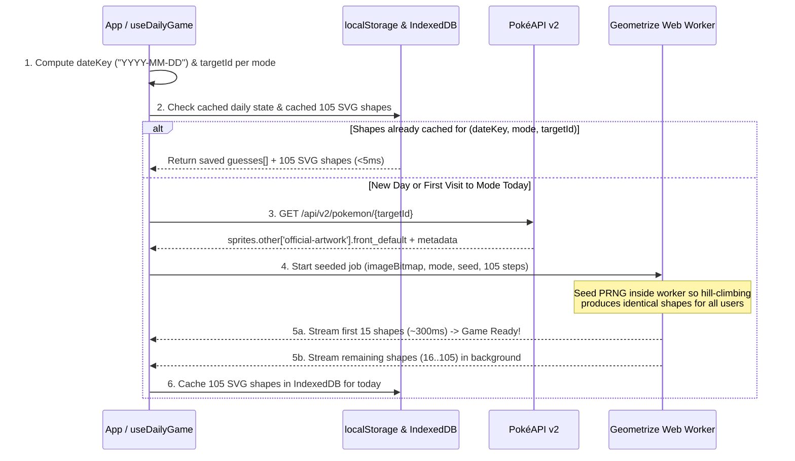

# PokéShapes — Implementation Plan

## 1. Overview & Vision
**PokéShapes** is a daily Pokémon guessing web application (inspired by Wordle and *Who's That Pokémon?*) where players identify the daily Pokémon from a progressive geometric primitive reconstruction of its official artwork.

Every day at midnight, **three distinct daily puzzles** refresh—one for each geometric primitive mode powered by [Tw1ddle/geometrize](https://github.com/Tw1ddle/geometrize) (`geometrizejs`):
1. **Circles Mode** (`ShapeTypes.CIRCLE`)
2. **Triangles Mode** (`ShapeTypes.TRIANGLE`)
3. **Lines Mode** (`ShapeTypes.LINE`)

Each game begins with **15 shapes**. Every incorrect guess adds **+10 shapes** to the canvas (`15 → 25 → 35 → 45 → 55 → 65 → 75 → 85 → 95 → 105`) until the player either guesses the Pokémon correctly or exhausts all **10 guesses**.

---

## 2. Tech Stack & Architecture

- **Framework & Build Tool**: React 18 + TypeScript + Vite (fast HMR, clean modular architecture, client-side SPA).
- **Styling & Theme System**: Tailwind CSS + custom CSS variables for dynamic theming (Sleek Gamer Dark Mode, Poké-Lab Light Mode, and Color-Blind Accessible Palettes).
- **Geometrization Engine**: [`geometrizejs`](https://github.com/Tw1ddle/geometrize) (the official JS library for `Tw1ddle/geometrize`) running inside a dedicated **Web Worker** (`geometrize.worker.ts`) so hill-climbing shape generation never blocks UI animations.
- **Data Source (Consumption-Only API)**: [PokéAPI v2](https://pokeapi.co/docs/v2)
  - Master Pokémon index (`GET https://pokeapi.co/api/v2/pokemon?limit=1025`) for instant autocomplete search and daily selection pool.
  - Pokémon details (`GET https://pokeapi.co/api/v2/pokemon/{id}`) consuming `sprites.other["official-artwork"].front_default` along with Pokémon types, generation, height, and weight.
- **State & Persistence**: `localStorage` + `IndexedDB` (for caching the PokéAPI list, daily game state per mode, cached daily SVG shape steps, user settings, and lifetime statistics/streaks).



---

## 3. Daily Puzzle Engine: Scheduling, Randomization & Generation Lifecycle

Because PokéShapes uses PokéAPI as a **consumption-only API** without requiring a custom backend database, the "Daily Puzzle" system is driven by a **Deterministic Seeded Permuted Deck Engine** synchronized to the calendar date. This ensures every player gets the exact same daily Pokémon AND the exact same geometric shape layout on any given day.

### 3.1 When Does a New Puzzle Happen? (Midnight Rollover & Epoch Indexing)
- **Daily Reset Time**: Puzzles refresh every day at **00:00:00 (Midnight) local time** (`YYYY-MM-DD`), matching standard Wordle behavior.
- **Epoch & Puzzle Numbering**:
  - We define a fixed reference epoch: `EPOCH_DATE = "2026-10-21"` (PokéShapes Puzzle `#1`).
  - For any calendar date `YYYY-MM-DD`, we compute the integer `dayIndex` using UTC-normalized midnight timestamps of the local `YYYY-MM-DD` components (avoiding Daylight Saving Time drift):
    $$\text{dayIndex} = \left\lfloor \frac{\text{Date.UTC}(Y, M, D) - \text{Date.UTC}(2026, 9, 21)}{86{,}400{,}000} \right\rfloor$$
  - `puzzleNumber = dayIndex + 1` (displayed in the header as `Daily Puzzle #1`, `#2`, etc.).
- **Live Midnight Watcher (`useMidnightRollover`)**:
  - A 1-second interval hook computes the remaining `HH:MM:SS` until `24:00:00` for the Statistics countdown timer.
  - If the user has the browser tab open when the clock crosses `00:00:00` (`currentDateKey !== activeDateKey`), the app automatically transitions to the new day's `dateKey`, resets the active board for the new day, reconciles streaks, and generates the new day's puzzles without requiring a manual page reload.

### 3.2 How Does the App Choose & Randomize Each Day's Pokémon?
Simple random modulo selection (`random(date) % 1025`) suffers from the **birthday paradox**—causing repeat Pokémon within weeks and risking two modes picking the same Pokémon on the same day. Instead, PokéShapes uses a **Seeded Fisher-Yates Deck Shuffle with Cross-Mode Collision Prevention**:

1. **String Hashing (`cyrb128` / `FNV-1a`) + Seeded PRNG (`Mulberry32`)**:
   - We implement a pure, deterministic 32-bit PRNG (`mulberry32(seed)`) seeded by hashing a string key. Given the same input string, it produces the exact same sequence of floats in `[0, 1)` across all browsers and OSs.
2. **Non-Repeating 1,025-Day Cycle Deck Shuffle**:
   - Let $N = 1025$ (all mainline Pokémon IDs `1..1025`).
   - Any `dayIndex` maps to a cycle and a slot within that cycle:
     $$\text{cycleNumber} = \lfloor \text{dayIndex} / 1025 \rfloor, \quad \text{slotIndex} = \text{dayIndex} \bmod 1025$$
   - For each mode $m \in \{\text{circles}, \text{triangles}, \text{lines}\}$, we seed the PRNG with `"pokeshapes-deck-v1:${m}:cycle-${cycleNumber}"` and perform an in-place **Fisher-Yates shuffle** of `[1, 2, ..., 1025]`.
   - This guarantees **zero repeat Pokémon** within a mode across an entire 1,025-day ($\approx 2.8\text{-year}$) cycle!
3. **Same-Day Cross-Mode Collision Guard**:
   - On any single day `dayIndex`, all three modes (`Circles`, `Triangles`, `Lines`) must select **three distinct Pokémon**:
     - `circlesId = circlesDeck[slotIndex]`
     - `trianglesId` starts at `trianglesDeck[slotIndex]`; if `trianglesId === circlesId`, it advances to `trianglesDeck[(slotIndex + 1) % 1025]`.
     - `linesId` starts at `linesDeck[slotIndex]`; while `linesId === circlesId || linesId === trianglesId`, it advances to the next slot `(slotIndex + k) % 1025`.

```typescript
// Deterministic Daily Selection Pseudocode (src/utils/dailySeed.ts)
export function getDailyTargets(dateKey: string): Record<GameMode, number> {
  const dayIndex = getDayIndexFromEpoch(dateKey); // 0, 1, 2, ...
  const TOTAL_POKEMON = 1025;
  const cycle = Math.floor(dayIndex / TOTAL_POKEMON);
  const slot = dayIndex % TOTAL_POKEMON;

  const circlesDeck = buildShuffledDeck(`pokeshapes-v1:circles:cycle-${cycle}`, TOTAL_POKEMON);
  const trianglesDeck = buildShuffledDeck(`pokeshapes-v1:triangles:cycle-${cycle}`, TOTAL_POKEMON);
  const linesDeck = buildShuffledDeck(`pokeshapes-v1:lines:cycle-${cycle}`, TOTAL_POKEMON);

  const circlesId = circlesDeck[slot];

  let tSlot = slot;
  while (trianglesDeck[tSlot] === circlesId) {
    tSlot = (tSlot + 1) % TOTAL_POKEMON;
  }
  const trianglesId = trianglesDeck[tSlot];

  let lSlot = slot;
  while (linesDeck[lSlot] === circlesId || linesDeck[lSlot] === trianglesId) {
    lSlot = (lSlot + 1) % TOTAL_POKEMON;
  }
  const linesId = linesDeck[lSlot];

  return {
    circles: circlesId,
    triangles: trianglesId,
    lines: linesId,
  };
}
```

### 3.3 How Does the App Generate the Geometrized Puzzle Each Day?
Even for the same Pokémon sprite, `geometrizejs` uses random hill-climbing mutations to place shapes. To ensure **every player sees the exact same 105 shapes**, and to make puzzle generation fast and seamless, the app executes a 4-stage pipeline:



1. **Seeded Hill-Climbing Inside Web Worker**:
   - Before invoking `new ImageRunner(bitmap)` and `runner.step(options)`, `geometrize.worker.ts` installs a seeded `Math.random` replacement initialized with `hashSeed("pokeshapes-shapes:${dateKey}:${mode}:${pokemonId}")`.
   - Because `geometrizejs` calls `Math.random()` internally for random shape initialization and mutation, seeding `Math.random` inside the isolated Web Worker makes the hill-climbing algorithm **100% deterministic**.
2. **Two-Stage Streaming (15 Shapes Immediate + 90 Shapes Background)**:
   - **Stage A (Immediate Playability)**: The worker runs steps `1..15` first and posts `INITIAL_BATCH_READY` to the main thread. The player can immediately view the initial 15-shape puzzle and start guessing within ~300–500ms.
   - **Stage B (Zero-Latency Wrong Guesses)**: While the player is contemplating their first guess, the worker continues stepping `16..105` in the background. When the player makes a wrong guess, revealing shapes `16..25` (`25` total), `26..35` (`35` total), etc. happens **instantly (0ms)** by slicing the pre-computed array `shapes.slice(0, 15 + wrongGuesses * 10)`.
3. **Daily State Persistence & Cache Eviction**:
   - Progress for today is stored in `localStorage` under `pokeshapes:dailyState` keyed by `dateKey`:
     - Stores per-mode `{ targetPokemonId, guesses: GuessRecord[], status: 'playing' | 'won' | 'lost', completedAt?: number }`.
   - When a new day starts (`storedDateKey !== todayDateKey`), the previous day's board state is archived into lifetime statistics, `IndexedDB` shape caches from prior days are purged, and a clean board for `todayDateKey` is initialized.

---

## 4. Core Mechanics & Game Flow

### 4.1 Three Daily Game Modes (Shapes)
| Mode | Geometrize Primitive | Visual Character | Daily Selection |
| :--- | :--- | :--- | :--- |
| **Circles** | `ShapeTypes.CIRCLE` | Overlapping translucent orbs/bubbles | Deterministic deck: `circles` |
| **Triangles** | `ShapeTypes.TRIANGLE` | Low-poly shard/crystal reconstruction | Deterministic deck: `triangles` |
| **Lines** | `ShapeTypes.LINE` | Vector sketch / wireframe strokes | Deterministic deck: `lines` |

- Players can switch freely between the **Circles**, **Triangles**, and **Lines** tabs at any time; progress in each mode is tracked and saved independently each day.

### 4.2 Guess & Shape Progression Rules
- **Initial State (Guess 1)**: `15` shapes rendered on the viewport.
- **Wrong Guess Penalty**: Each wrong guess increments the visible shape count by `+10` shapes and consumes 1 of 10 guesses:
  $$\text{Shapes Visible}(g) = 15 + 10 \times g \quad \text{for } g \in \{0, 1, \dots, 9\}$$
  - **0 wrong guesses** (Guess 1 active): **15 shapes**
  - **1 wrong guess** (Guess 2 active): **25 shapes**
  - **2 wrong guesses** (Guess 3 active): **35 shapes**
  - **3 wrong guesses** (Guess 4 active): **45 shapes**
  - **4 wrong guesses** (Guess 5 active): **55 shapes**
  - **5 wrong guesses** (Guess 6 active): **65 shapes**
  - **6 wrong guesses** (Guess 7 active): **75 shapes**
  - **7 wrong guesses** (Guess 8 active): **85 shapes**
  - **8 wrong guesses** (Guess 9 active): **95 shapes**
  - **9 wrong guesses** (Guess 10 / Final Guess): **105 shapes**
- **Step History Scrubber**: Players can scrub back and forth across unlocked shape tiers (`15`, `25`, `35`, …) to see how the image evolved.
- **Guess Feedback History**: Each submitted guess displays the guessed Pokémon's mini-artwork, name, Pokédex number, and optional attribute comparison badges (Generation, Type 1/2 match, Height/Weight directional indicators) with color-blind-safe icons (`✓`, `↑`, `↓`, `≈`).
- **End-of-Game Reveal**: When the player guesses right or uses all 10 guesses:
  - A celebration/summary panel appears with an interactive comparison between the **Geometrized Sprite** and the **Original Official Artwork** (`front_default`).
  - A **Share Results** button copies a Wordle-style spoiler-free summary to the clipboard.

---

## 5. Geometrize Pipeline Details

1. **Sprite Fetching & Canvas Normalization**:
   - Fetch the daily Pokémon's `sprites.other['official-artwork'].front_default` with `crossOrigin = "anonymous"`.
   - Composite onto a standardized `256×256` RGBA buffer in the Web Worker, cropping/centering around non-transparent Pokémon pixels so candidate shapes focus on the Pokémon rather than empty margins.
2. **Shape Configuration per Mode**:
   - **Circles (`ShapeTypes.CIRCLE`)**: `alpha: 160`, `candidateShapesPerStep: 60`, `shapeMutationsPerStep: 100`.
   - **Triangles (`ShapeTypes.TRIANGLE`)**: `alpha: 165`, `candidateShapesPerStep: 60`, `shapeMutationsPerStep: 100`.
   - **Lines (`ShapeTypes.LINE`)**: `alpha: 210`, `candidateShapesPerStep: 75`, `shapeMutationsPerStep: 120`, with custom SVG `stroke-width` and `stroke-linecap="round"` styling so `LINE` primitives render as bold, vibrant geometric strokes.

---

## 6. UI/UX, Theme & Settings

### 6.1 Pokémon-Themed Sleek Gamer Aesthetic
- **Header & Navigation**: Custom PokéShapes geometric logo, daily puzzle badge (`Daily #1 · Oct 21`), mode selector pills (`● Circles`, `▲ Triangles`, `╱ Lines`) with live status indicators (`In Progress`, `✓ Won`, `✕ Lost`), and quick-action buttons for **How to Play**, **Statistics**, and **Settings**.
- **Interactive Viewport**: Framed like a sleek modern Pokédex scanner with live shape counter badge (`15 / 105 Shapes`), remaining guesses gauge (`10 Guesses Left`), step scrubber, and smooth SVG shape entrance animations.
- **Autocomplete Search Bar**: Instant fuzzy filtering across all Pokémon from PokéAPI with keyboard navigation (`↑`, `↓`, `Enter`, `Esc`), preventing duplicate guesses.

### 6.2 Settings Modal
1. **Appearance (Light / Dark Mode)**:
   - **Dark Mode (Default)**: Deep obsidian/cyber-slate background with neon Pokédex cyan, crimson, and electric gold accents.
   - **Light Mode**: Crisp Silph Co. alabaster/pearl surface with high-contrast slate typography and Pokéball red accents.
2. **Color Blind Mode**:
   - Accessible color palettes (**Standard**, **Deuteranopia/Protanopia Safe** [Blue/Orange], **Tritanopia Safe** [Cyan/Magenta]) plus symbolic badge indicators on all guess feedback chips and an optional high-contrast canvas background toggle.
3. **Gameplay & Accessibility Preferences**:
   - **Shape Reveal Animation**: Toggle smooth transition when +10 shapes are added vs. instant render.
   - **Attribute Hints**: Toggle whether wrong guesses also display Pokédex attribute hints (Type/Gen/Size) or pure Shape-Only Hard Mode.
   - **Sound Effects**: Toggle synthesized Pokédex UI chimes.

### 6.3 Statistics Modal & Streak Logic
- **Mode Tabs**: View stats for **All Modes**, **Circles**, **Triangles**, or **Lines**.
- **Streak Rules**:
  - **Per-Mode Streak**: Increments by `+1` each consecutive calendar day (`dayIndex === lastWonDayIndex + 1`) that the user wins that specific shape mode. Resets to `0` if a day is missed or lost.
  - **Overall Daily Streak**: Increments by `+1` each consecutive calendar day that the user wins at least one daily mode (with a "Triple Crown" badge counter for days where all 3 modes are won!).
- **KPI Cards**:
  - **Played** (Total daily games completed)
  - **Win %** (Percentage of games won)
  - **Current Streak** (Consecutive days won)
  - **Max Streak** (All-time best daily streak)
- **Guess Distribution Chart**: Horizontal bar chart for guesses `1` through `10` (and `X` for losses), highlighting today's result.
- **Daily Countdown**: Live `HH:MM:SS` countdown until midnight (`00:00:00`) + one-click **Share** button.

---

## 7. Proposed Directory Structure (`E:\Argon\PokeShapes`)

```text
E:\Argon\PokeShapes\
├── docs\
│   ├── IMPLEMENTATION_PLAN.md                     # Detailed architecture & implementation plan
│   ├── ARCHITECTURE.md                            # Data flow, Geometrize worker, and PokéAPI spec
│   ├── GAME_DESIGN.md                             # Rules, modes, accessibility & UI specifications
│   └── COMPETITIVE_RESEARCH_AND_IMPROVEMENTS.md   # Competitive benchmarks & v2.0 feature specs
├── public\
│   └── favicon.svg                                # Geometric Pokéball icon
├── src\
│   ├── api\
│   │   └── pokeapi.ts                             # Consumption-only PokéAPI v2 client, species habitat & alpha auto-crop
│   ├── components\
│   │   ├── Header.tsx                             # Navigation, PolyDex badge, Archive trigger, mode switcher
│   │   ├── ModeSelector.tsx                       # Circles / Triangles / Lines daily tabs
│   │   ├── GeometrizeCanvas.tsx                   # SVG renderer, scrubber, timelapse replay, SVG/PNG export, Give Up
│   │   ├── ScannerClues.tsx                       # Progressive clues (3=Gen, 5=Type, 7=Habitat) + Official Cry audio
│   │   ├── ArchiveModal.tsx                       # Yesterday's Champions showcase & Past Daily Archive picker
│   │   ├── PolyDexModal.tsx                       # Personal PolyDex collection grid & Trainer Ranks
│   │   ├── PokemonSearch.tsx                      # Autocomplete combobox for submitting guesses
│   │   ├── GuessList.tsx                          # History of guesses (+10 shapes indicator & hints)
│   │   ├── StatsModal.tsx                         # Streaks, win %, guess distribution chart, rich emoji grid share
│   │   ├── SettingsModal.tsx                      # Light/Dark mode, Color Blind mode, Hard mode, audio
│   │   └── HowToPlayModal.tsx                     # Rules & visual examples of the 3 shape modes
│   ├── workers\
│   │   └── geometrize.worker.ts                   # Seeded Web Worker running geometrizejs (15 -> 105 shapes)
│   ├── hooks\
│   │   ├── useDailyGame.ts                        # Core game loop, archive dates, gen filter, Give Up, PolyDex
│   │   ├── useMidnightRollover.ts                 # Live countdown & automatic midnight puzzle rollover
│   │   ├── useGeometrize.ts                       # Worker lifecycle, IndexedDB caching & idle background pre-generation
│   │   └── useSettings.ts                         # Theme, color-blind palette, and user preferences
│   ├── types\
│   │   ├── pokemon.ts                             # PokéAPI response & internal Pokémon models (incl. habitat & genus)
│   │   ├── game.ts                                # Mode types, guess records, PolyDex, Trainer Ranks, GenerationFilter
│   │   └── geometrizejs.d.ts                      # TypeScript declarations for geometrizejs
│   ├── utils\
│   │   ├── dailySeed.ts                           # Mulberry32 PRNG, Fisher-Yates deck shuffle, epoch & archive math
│   │   ├── storage.ts                             # localStorage / IndexedDB persistence helpers & Trainer Rank math
│   │   └── sound.ts                               # Web Audio API Pokédex chimes & Official Pokémon Cry player
│   ├── App.tsx
│   ├── main.tsx
│   └── index.css                                  # Theme tokens, color-blind palettes, animations
├── index.html
├── package.json
├── tsconfig.json
└── vite.config.ts
```

---

## 8. Implementation Phases

1. **Phase 1 — Documentation & Project Scaffolding**:
   - Complete `E:\Argon\PokeShapes\docs` documentation (`ARCHITECTURE.md`, `GAME_DESIGN.md`).
   - Scaffold the Vite + React + TypeScript project in `E:\Argon\PokeShapes` and install dependencies (`geometrizejs`, `lucide-react`, `tailwindcss`, `canvas-confetti`).
2. **Phase 2 — PokéAPI Client & Daily Seed Engine**:
   - Implement `dailySeed.ts` (Epoch day calculation, Mulberry32 PRNG, 1,025-Pokémon Fisher-Yates cycle shuffle, cross-mode collision guard) and `useMidnightRollover.ts`.
   - Implement `pokeapi.ts` to fetch the Pokémon index and individual Pokémon records using `sprites.other["official-artwork"].front_default`.
3. **Phase 3 — Seeded Geometrize Web Worker & Progressive SVG Renderer**:
   - Implement `geometrize.worker.ts` using `geometrizejs` (`Bitmap`, `ImageRunner`, `ShapeTypes`, `SvgExporter`) with deterministic PRNG seeding supporting `CIRCLE`, `TRIANGLE`, and `LINE`.
   - Implement progressive streaming (initial 15 shapes first, remaining 90 shapes pre-computed in background up to 105 shapes) and IndexedDB caching.
4. **Phase 4 — Core Game Loop & Gamer UI**:
   - Build the Pokédex-inspired viewport, mode tabs, autocomplete Pokémon guess input, guess history cards, and post-game original artwork comparison slider.
5. **Phase 5 — Settings, Accessibility & Statistics**:
   - Implement Light/Dark mode, Color Blind mode palettes & icons, Statistics dashboard (streaks, win rate, 1–10 guess distribution, live midnight countdown, shareable emoji grid), and How-to-Play guide.
6. **Phase 6 — Verification & End-to-End Testing**:
   - Verify build, test all 3 shape modes (15 initial shapes, +10 shapes per wrong guess up to 10 guesses / 105 shapes), test midnight rollover and deterministic seed consistency, and verify PokéAPI artwork loading.
7. **Phase 7 — Competitive & Technical Enhancements (`v2.0`)**:
   - **2.1 Scanner Clues & Official Cry Audio**: Progressive clues at **3 wrong guesses** (Generation), **5 wrong guesses** (Primary Type), and **7 wrong guesses** (Habitat + Official Pokémon Cry `cries.latest`).
   - **2.2 Timelapse Replay & Art Export**: Post-game `1 → 105` shape timelapse animation and one-click **SVG / PNG (`1024×1024`)** downloads.
   - **2.3 Yesterday's Champions & Past Daily Archive Picker**: View yesterday's 3 answers and play any historical daily puzzle since Epoch (`2026-09-22`).
   - **2.4 PolyDex Collection & Trainer Ranks**: Track caught species per shape mode (`●`, `▲`, `╱`) and progress from *Rookie Scanner* to *PokéShapes Grand Master*.
   - **2.5 Unlimited Generation Filter & Universal Give Up / Reveal**: Filter Unlimited Mode by Generation (`All`, `Gen I–IX`) and allow a 2-step **Give Up / Reveal Pokémon** action in both Daily and Unlimited modes.
   - **3.1 Alpha Bounding-Box Auto-Crop**: Scan sprite alpha channel (`alpha > 16`) before geometrization so every Pokémon fills 88% of the `180×180` bitmap.
   - **3.2 Idle Background Pre-Generation**: Automatically pre-generate and cache sibling daily shape modes in `IndexedDB` once the active mode finishes.
   - **3.3 Thicker Line Rasterization Tuning**: Higher mutation density (`95 × 130`), higher alpha (`235`), and graduated stroke widths (`6.4px / 4.8px / 3.5px`) for `Lines Mode`.
   - **3.4 Richer Emoji Grid Sharing**: Per-guess `[Gen, Types, Height, Weight]` emoji grid (`🟩🟨🔼🔽⬛`) with shape counts in clipboard share output.
